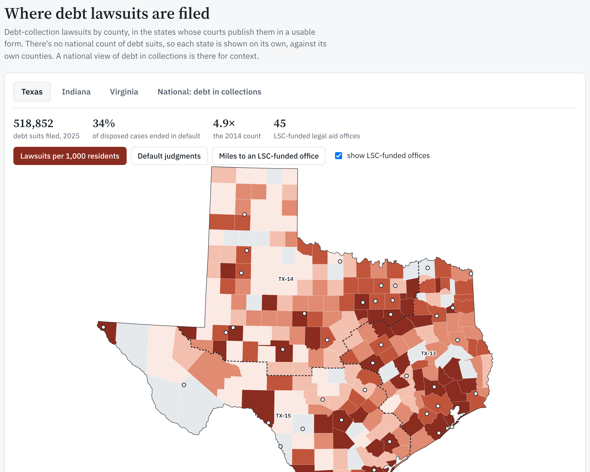

# Justice Gap Map

**Where are debt-collection lawsuits filed, and where is civil legal aid thin?**

Debt collectors file hundreds of thousands of lawsuits a year in state courts. Most end in default judgments against people who never show up, often people who had a defense, or didn't know they could negotiate. This project pulls public court, credit, complaint, Census, and legal aid data into one place to show where that pressure falls and how it lines up with the help available.

It's a personal project: part research, part a working example of a small, reviewable data pipeline on AWS.

[](https://adamfriedl.github.io/justice-gap-map/)

**[Open the interactive map →](https://adamfriedl.github.io/justice-gap-map/)** Each state with court data (Texas, Indiana, Virginia) gets its own view: lawsuit rates, default judgments, filings over time, and the highest-rate counties. Texas adds legal aid offices, service areas, and distance to the nearest office. A national view shows debt in collections for context.

## What it shows so far

**Debt suits are surging** ([docs/lawsuits](docs/lawsuits/README.md)):
- Texas justice courts took 106,061 debt claims in 2014 and **518,852 in 2025**, up 33% from 2024 alone.
- Indiana collection cases rose from 67,683 (2014) to **140,846 (2024)**. **68%** of those disposed in 2024 ended in default judgments.

**Where they're filed isn't simply where the poverty is:**
- Indiana and Virginia suits concentrate where debt and poverty are high.
- Texas's highest rates are in fast-growing suburbs around Dallas–Fort Worth and Houston (Kaufman, Ellis, Brazoria), not the poorer border counties.
- So no single national measure stands in for court data.

**In Texas, LSC-funded legal aid offices are where the suits are; the difference is volume** ([docs/legal-aid/texas.md](docs/legal-aid/texas.md)):
- 81% of 2025 debt suits were filed in the 43 counties with an LSC-funded legal aid office. The highest-rate counties without one are suburbs 20 to 35 miles from a metro office.
- Each of the state's three legal aid service areas has 14 to 16 offices. Debt suits per eligible resident range from 81 to 120 per 1,000.

**Common proxies fail** (early data checks, [docs/phase0](docs/phase0/)):
- *CFPB complaints* don't measure need. In Texas, the poorest counties have the most debt in collections and the fewest complaints, and complaint rates barely track lawsuit rates ([write-up](docs/phase0/complaints-vs-need.md)).
- *LSC funding* doesn't measure legal aid capacity. The federal formula is nearly flat per eligible person, while total legal aid nonprofit revenue runs from $18 to $275 per eligible person across states (outside DC) ([write-up](docs/phase0/lsc-funding-vs-capacity.md)).
- LSC's 130 service areas can be rebuilt as county sets, so county data can be compared with legal aid geography ([write-up](docs/phase0/lsc-data-availability.md)).

Every number in these write-ups names its source, its download date, and the script that produced it.

## How it's built

```
State courts (TX, IN, VA, Harris County)   ┐
Urban Institute debt in collections        │   Python + DuckDB         county / service-area
CFPB complaints, Census ACS, HUD ZIP map   ├─► (scripts/) ──────────►  tables, map, write-ups
LSC service areas, IRS nonprofit revenue   ┘
```

- **So far (as of November 2026):** Python 3.12 scripts (managed with [uv](https://docs.astral.sh/uv/)) download each source and query it with [DuckDB](https://duckdb.org/). The CFPB file alone is ~6 GB, so no pandas.
- **Next:** the same jobs run on a schedule on AWS (details below).
- **Built with AI coding agents under written rules.** [AGENTS.md](AGENTS.md) sets the limits:
  - read-only AWS access for agents;
  - no names or addresses of people sued, ever;
  - downloaded data treated as untrusted;
  - every data fact cited or marked "not confirmed".

### Infrastructure

All of it is Terraform in [`infra/`](infra/), in two stacks.

| Stack | What it holds | How it changes |
| --- | --- | --- |
| [`infra/bootstrap/`](infra/bootstrap/) | Terraform's state bucket; the link that lets GitHub Actions sign in to AWS (OIDC); the two CI roles; the ceiling on what AI agents can do; a monthly budget alert | Rarely. Applied by hand by the maintainer, with a temporary key that's deleted afterward ([runbook](docs/aws-setup.md)) |
| [`infra/main/`](infra/main/) | The pipeline: data buckets, query engine (Athena), scheduled jobs. Empty so far; the pipeline is the next step. | Through pull requests only |

**How an infrastructure change ships:**
1. A pull request changes something in `infra/main/`.
2. GitHub Actions signs in to AWS with a short-lived token (OIDC) and posts `terraform plan`, a preview of exactly what will change. The plan role is read-only.
3. The maintainer reads the plan and merges. Merging is the approval.
4. Actions runs `terraform apply` on `main` with the apply role.

No AWS keys are stored in GitHub or anywhere else. The apply role is admin-level because it builds the pipeline, but explicit denies stop it from changing its own trust, the CI roles, the agents' ceiling, or the state bucket. A bad merge can break the pipeline, but it can't take over the account.

**How the data will update (planned):**
- Each source gets its own scheduled job, on the source's own rhythm: Harris County cases daily, CFPB weekly, Texas and Virginia court counts monthly, Indiana quarterly, Census and LSC yearly.
- Raw downloads are kept as dated snapshots, so every number can be traced to the file it came from. The CFPB archive is locked against deletion.
- A weekly job compares each county's filings with its own recent history and emails a summary when something moves well outside the usual range.
- Idle cost is near zero, with a budget of about $10/month.

## Why these states

There's no national count of debt lawsuits. Each state's courts decide what to publish, and most don't separate debt cases, publish by county, or publish at all. The project covers states where the courts publish debt suits by county, free and in a form a script can read:

| State | What the courts publish | Why it's useful |
| --- | --- | --- |
| **Texas** | A "Debt Claim" case type in justice courts since 2013, with county counts of filings, defaults, and dispositions ([OCA](https://card.txcourts.gov/)); plus Harris County's daily case-level extract | The largest volume of the three (518,852 suits in 2025), a 12-year series, and one county with case-level detail: who files, claim amounts, outcomes |
| **Indiana** | A "Collection" case type with county counts ([ICOR](https://publicaccess.courts.in.gov/ICOR/)) | A clean statewide series, and default judgments for every county |
| **Virginia** | Monthly General District Court filing reports (PDF) | Court-level counts that track LSC's earlier warrant-in-debt figures closely (Spearman 0.75) |

Texas was also the test state for the early data checks. Next candidates come from LSC's Baseline Court Statistics, which lists states whose courts report debt case types by county. Idaho's court dashboard is the most promising. Maps say which states are covered; a blank state means no data, not no lawsuits.

## Privacy

People sued for debt are private individuals. Case-level court feeds are reduced in memory to non-identifying fields before anything is written: no names, no street addresses ([`scripts/lawsuits_fetch_harris.py`](scripts/lawsuits_fetch_harris.py), with a test). Only aggregate tables are committed.

## Repository

| Path | What |
| --- | --- |
| [`docs/prd.md`](docs/prd.md) | The plan: goals, data sources, metrics |
| [`docs/lawsuits/`](docs/lawsuits/) | Debt-lawsuit counts by county (TX, IN, VA) and what they show |
| [`docs/legal-aid/`](docs/legal-aid/) | Where LSC-funded legal aid offices are, set next to debt suits (Texas) |
| [`docs/phase0/`](docs/phase0/) | Early data checks: which measures hold up and which don't |
| [`scripts/`](scripts/) | Download and analysis scripts |
| [`site/`](site/) | The interactive map, published on GitHub Pages; rebuilt with `scripts/lawsuits_map.py` |
| [`infra/`](infra/) | Terraform: `bootstrap/` (state, CI roles, budget) and `main/` (pipeline) |
| [`tests/`](tests/) | Tests, including the privacy filter |

## Run it

```bash
uv sync
```

```bash
export CENSUS_API_KEY=...   # https://api.census.gov/data/key_signup.html
export HUD_API_TOKEN=...    # https://www.huduser.gov/portal/dataset/uspszip-api.html
```

Then follow the "Reproduce" steps in [docs/lawsuits/README.md](docs/lawsuits/README.md). Downloads go in `data/`, which is gitignored; raw data never goes in git. A few sources need a manual download: [docs/manual-downloads.md](docs/manual-downloads.md).

```bash
uv run pytest -q
```

## Where it stands

Done as of November 2026:
- Data checks: complaints and LSC funding failed as measures; court filings, debt in collections, and IRS revenue replaced them.
- Debt-suit counts by county for Texas, Indiana and Virginia, and the interactive map.
- Legal aid office locations for Texas, set next to debt suits, and a map with one view per state.
- The AWS foundation: Terraform state, CI that signs in with OIDC, plan on every PR, apply on merge.

**Next steps:**
- Build the pipeline on AWS, so court counts refresh on their own (Harris County daily, state counts monthly), with a weekly alert when a county or filer moves sharply.
- Add Idaho, the most promising next state.

**Possible later:**
- Legal aid office locations for Indiana and Virginia, so the Texas comparison can be repeated.
- New York, if its caseload reports break out consumer credit cases ([what was checked](docs/lawsuits/new-york.md)).
- Who files: the largest plaintiffs and their outcomes, from Harris County's case-level data.
- A plain-English question box over the data that shows the query it ran.
- The long-term aim: plain-language guides to the debt-suit process, aimed first at the places this map shows need them most.

The project is purely informational. It reports what public records show about places, not why, and it doesn't call out or judge legal aid providers or their funders. The businesses that file the suits are named, with every figure sourced to court records.

## License

Code: [MIT](LICENSE). Data belongs to its sources (state courts, CFPB, Census Bureau, HUD, LSC, IRS, Urban Institute), under their own terms. The derived tables in `docs/` cite each one.
